_This project has been created as part of the 42 curriculum by messengu, armosnie, eazard, tlay._

# FT GoodVibes

## Description

**FT GoodVibes** is a web platform where independent artists upload and publish their music, and
listeners discover it, organise it in playlists, follow artists and share tracks with their
friends in real time.

The goal of the project is to build a complete, multi-user web application (frontend, backend
and database) that can be deployed with a single command, while exploring a microservice
architecture, real-time communication and production-style monitoring.

### Key features

- **Accounts**: sign-up and login with email and password (Argon2 hashing), session token,
  rate-limited authentication endpoints.
- **Profiles**: username, display name, bio and avatar (default avatar when none is uploaded),
  public artist pages.
- **Friends and presence**: add or remove friends, see who is online.
- **Real-time chat**: one-to-one conversations between friends over WebSocket, track sharing,
  read receipts, message deletion and persistent history.
- **Music publishing**: upload of singles, EPs, albums and mixtapes with ordered multi-file
  imports, cover art (embedded artwork extracted automatically), drafts and edits after
  publication.
- **Catalogue**: search of artists, projects and tracks, with categories and pagination.
- **Library**: liked tracks, saved projects, followed artists, private or public playlists with
  stable share links.
- **Player**: shared desktop player with queue, shuffle, repeat, seek and volume, restored after
  a reload; private listening history.
- **Three languages**: French, English and Spanish, with a language selector on every page.
- **Operations**: Prometheus metrics and alerts, Grafana dashboards, a status page and automated
  daily backups with a restore procedure.
- **Legal pages**: Privacy Policy and Terms of Service, linked from the footer of every page.

## Instructions

### Prerequisites

- Docker Engine with the Docker Compose v2 plugin (`docker compose`).
- GNU Make.
- Free local ports **1443** (HTTPS) and **1080** (HTTP, redirected to HTTPS).
- The latest stable version of Google Chrome.

### 1. Configure the environment

```sh
cp .env.example .env
```

Replace every `change_me` value in `.env` with your own secrets. `.env` is ignored by Git;
`.env.example` only contains placeholder values. It defines:

- `DB_USER`, `DB_PASSWORD`, `DB_NAME`: the local PostgreSQL administrator, used only to create
  the database, the schemas and the roles.
- `<SERVICE>_MIGRATION_PASSWORD` / `<SERVICE>_RUNTIME_PASSWORD` and the matching
  `*_DATABASE_URL` values: two dedicated database accounts per service (one for migrations,
  one for runtime queries).
- `JWT_SECRET` and `INTERNAL_SERVICE_TOKEN`: two different long random values.
- `GRAFANA_ADMIN_USER`, `GRAFANA_ADMIN_PASSWORD`: Grafana credentials.
- `AUTH_SIGNUP_RATE_LIMIT`, `AUTH_LOGIN_RATE_LIMIT` (optional): requests per minute accepted on
  sign-up and login.

Every variable is described in [ENVIRONMENT.md](ENVIRONMENT.md).

### 2. Start the project

```sh
make setup        # docker compose up -d --build
```

On a fresh volume, PostgreSQL creates the roles and schemas, the migration containers apply the
Prisma migrations, the permissions are granted, then the HTTP services start.

| URL                                           | Content            |
| --------------------------------------------- | ------------------ |
| https://localhost:1443                        | the application    |
| https://localhost:1443/status                 | status page        |
| https://localhost:1443/monitoring/grafana/    | Grafana dashboards |
| https://localhost:1443/monitoring/prometheus/ | Prometheus         |

The certificate is self-signed: accept it once in the browser.

Optional demo tracks:

```sh
docker compose exec catalog-service npm run seed:demo
docker compose exec media-service npm run seed:demo
```

### 3. Other commands

```sh
make logs                     # follow the logs of every container
make down                     # stop the stack
make backup                   # manual backup (database, audio files, avatars)
make restore DIR=backups/...  # restore a backup
```

Database roles are only created on a new volume: after pulling a version that adds variables,
rebuild the database with `docker compose down --volumes`.

### 4. Tests

| Command                                    | What it checks                                                                            |
| ------------------------------------------ | ----------------------------------------------------------------------------------------- |
| `bash tests/e2e/run.sh`                    | auth and users, HTTPS, SQL, restarts, Chromium journey ([guide](tests/e2e/README.md))     |
| `bash tests/music/run.sh playback`         | catalogue, media, library, playback on an isolated stack ([guide](tests/music/README.md)) |
| `bash tests/files/run.sh`                  | file upload and management on an isolated stack ([guide](tests/files/README.md))          |
| `bash tests/publication/run.sh`            | publication with real accounts ([guide](tests/publication/README.md))                     |
| `bash tests/projects/run.sh`               | project, library and player journey                                                       |
| `npm run test:languages --prefix frontend` | dictionaries and translation coverage                                                     |
| `node tests/chat/recette.mjs`              | chat scenario against the running stack                                                   |

The isolated test stacks use their own Compose project, ports and volumes, and do not touch the
development stack.

## Team Information

| Member   | Login    | Role(s)                    | Responsibilities                                               |
| -------- | -------- | -------------------------- | -------------------------------------------------------------- |
| Matis    | messengu | Technical Lead / Architect | Backend: microservices, APIs, authentication, real-time chat   |
| Armand   | armosnie | Test Lead                  | DevOps: Docker, Nginx, monitoring, backups                     |
| Emile    | eazard   | Product Owner              | Database: PostgreSQL container, schemas, roles and permissions |
| Tiphaine | tlay     | Project Manager            | Frontend: React interface, translations                        |

Roles (Product Owner, Project Manager, Technical Lead, Developers) will be assigned and
documented here.

## Project Management

- **Work organisation**: The project is split by domain (backend, DevOps, database, and frontend), with one owner per domain.
- **Meetings and planning**: The team holds one scheduled meeting per week to review progress, discuss blockers, and plan the next tasks. Additional informal check-ins are held when team members work together in person.
- **Version control**: Git and GitHub are used for version control, following the commit convention described below. The team pushes directly to `main`.
- **Project management tools**: GitHub is used to host and manage the repository, while Notion is used for task planning, documentation, and progress tracking.
- **Communication channels**: Discord is used for day-to-day communication, technical discussions, and coordination between team members.

### Git commit convention

```text
<type>(<module>): <description>
```

| Type       | Description                             | Example                                         |
| ---------- | --------------------------------------- | ----------------------------------------------- |
| `feat`     | Add a new feature                       | `feat(chat): add read receipts`                 |
| `fix`      | Fix a bug                               | `fix(web): fix rate limiting`                   |
| `refactor` | Improve code without changing behaviour | `refactor(backend): simplify service structure` |
| `docs`     | Documentation changes                   | `docs(web): update API documentation`           |
| `test`     | Add or modify tests                     | `test(web): add API authentication tests`       |
| `chore`    | Maintenance / configuration             | `chore: update Docker configuration`            |
| `style`    | Formatting / code style changes         | `style(web): format API routes`                 |
| `perf`     | Performance improvements                | `perf(player): isolate progress updates`        |
| `build`    | Build system / dependencies             | `build: update backend dependencies`            |
| `ci`       | CI/CD configuration                     | `ci: add GitHub Actions workflow`               |

## Technical Stack

| Layer          | Technologies                                                                                                  |
| -------------- | ------------------------------------------------------------------------------------------------------------- |
| Frontend       | React 19, TypeScript, Vite, custom CSS design tokens (no external CSS framework)                              |
| Backend        | Node.js, TypeScript, Fastify 5 (`@fastify/websocket`, `@fastify/rate-limit`, `@fastify/jwt`), TypeBox schemas |
| Database       | PostgreSQL 16 with Prisma 7 (ORM and migrations)                                                              |
| Real time      | WebSocket (chat-service)                                                                                      |
| Security       | Argon2 password hashing, JWT, HTTPS through Nginx, one database role pair per service                         |
| Infrastructure | Docker Compose, Nginx (reverse proxy, TLS), Prometheus, Grafana                                               |

### Justification of the main choices

- **Fastify**: fast, typed, and its schema validation lets every route reject invalid input
  before it reaches the code.
- **Microservices**: each domain (auth, users, catalogue, media, library, playback, chat) owns
  its data and can fail or restart without stopping the others.
- **PostgreSQL**: relational data with many relations (credits, releases, playlists), strong
  constraints and transactions; one schema per service keeps ownership explicit inside a single
  instance that stays simple to evaluate.
- **Prisma**: typed queries and versioned migrations for every service.
- **React**: its component-based architecture is well suited to a music streaming application with multiple views, reusable interface elements, and a persistent audio player.
- **Nginx**: single HTTPS entry point that routes `/api/<service>/` to each service and hides
  internal and metrics routes.

### Services

| Service            | Internal port | Responsibility                                |
| ------------------ | ------------- | --------------------------------------------- |
| `auth-service`     | 4000          | Identity and authentication                   |
| `user-service`     | 4001          | Profiles, avatars, friends and presence       |
| `catalog-service`  | 4002          | Artists, tracks, credits and releases         |
| `media-service`    | 4003          | Upload, validation and storage of media files |
| `library-service`  | 4004          | Playlists, favourites and saved items         |
| `playback-service` | 4005          | Listening sessions and progress               |
| `chat-service`     | 4006          | Conversations, messages and WebSocket         |

Backend organisation and rules: [backend/docs/CONVENTIONS.md](backend/docs/CONVENTIONS.md).
Service contents: [docs/STRUCTURE_SERVICES.md](docs/STRUCTURE_SERVICES.md).

## Database Schema

A single PostgreSQL instance holds one schema per service. Each service reads and writes only
its own schema, with its own runtime role. References between schemas are **logical**: they
store a UUID but have no foreign key, because each service is the only owner of its tables.

```mermaid
erDiagram
    ACCOUNTS ||--o{ OUTBOX_MESSAGES : emits
    PROFILES ||--o{ FRIENDS : has
    PROFILES ||--o| PRESENCES : has
    ARTISTS ||--o{ ARTIST_MEMBERS : "managed by"
    ARTISTS ||--o{ TRACK_ARTISTS : credited
    TRACKS ||--o{ TRACK_ARTISTS : credits
    ARTISTS ||--o{ RELEASE_ARTISTS : credited
    RELEASES ||--o{ RELEASE_ARTISTS : credits
    RELEASES ||--o{ RELEASE_TRACKS : contains
    TRACKS ||--o{ RELEASE_TRACKS : "appears in"
    GENRES ||--o{ TRACK_GENRES : classifies
    TRACKS ||--o{ TRACK_GENRES : "classified by"
    ASSETS ||--o{ VARIANTS : has
    PLAYLISTS ||--o{ PLAYLIST_ITEMS : contains
    PLAYLISTS ||--o{ PLAYLIST_CHANGES : versions
    SESSIONS ||--o{ EVENTS : receives
    CONVERSATIONS ||--o{ MESSAGES : contains
```



| Schema     | Tables                                                                                                                            | Key fields                                                                                                                                                                                                |
| ---------- | --------------------------------------------------------------------------------------------------------------------------------- | --------------------------------------------------------------------------------------------------------------------------------------------------------------------------------------------------------- |
| `auth`     | `accounts`, `outbox_messages`                                                                                                     | `accounts`: `id` uuid, `email` text unique, `password_hash` text, `state` text                                                                                                                            |
| `users`    | `profiles`, `friends`, `presences`, `inbox_messages`                                                                              | `profiles`: `user_id` uuid (= account id), `username` text unique, `display_name`, `bio`, `avatar_url`; `friends`: (`user_id`, `friend_id`); `presences`: `is_online` boolean, `last_seen_at` timestamptz |
| `catalog`  | `artists`, `artist_members`, `tracks`, `track_artists`, `releases`, `release_artists`, `release_tracks`, `genres`, `track_genres` | `tracks`: `id` uuid, `title`, audio asset uuid, `duration`, `status`; `releases`: `title`, `type` (single, EP, album, mixtape), `date`, cover, `status`                                                   |
| `media`    | `assets`, `variants`                                                                                                              | `assets`: `id` uuid, uploader uuid, usage, state, storage key, MIME type, size, duration, checksum; `variants`: rendition (MP3 preview), bitrate, size                                                    |
| `library`  | `playlists`, `playlist_items`, `playlist_changes`, `track_favorites`, `saved_items`                                               | `playlists`: `owner_id` uuid, `name`, `description`, `visibility`, `version`; `playlist_items`: track uuid, `position`                                                                                    |
| `playback` | `sessions`, `events`                                                                                                              | `sessions`: user uuid, track uuid, duration snapshot, time listened, sequence; `events`: (`session_id`, `sequence`) progress                                                                              |
| `chat`     | `conversations`, `messages`                                                                                                       | `conversations`: `user_a_id`, `user_b_id` (unique pair), last read message per user; `messages`: `id` bigint, `sender_user_id`, `body` (≤ 2000 chars), `track_id`, `deleted_at`                           |

Full column list, cardinalities and rebuild procedure: [docs/SCHEMA_DONNEES.md](docs/SCHEMA_DONNEES.md).
Prisma clients and commands: [backend/docs/PRISMA.md](backend/docs/PRISMA.md).

## Features List

| Feature                         | Description                                                                                                                                              | Member(s)                            |
| ------------------------------- | -------------------------------------------------------------------------------------------------------------------------------------------------------- | ------------------------------------ |
| Sign-up and login               | Email and password, Argon2 hash, JWT session restored after reload, rate limits                                                                          | Matis (backend), Tiphaine (frontend) |
| Profile management              | Edit username, display name and bio; upload or remove an avatar with progress, default avatar                                                            | Matis, Tiphaine                      |
| User directory and artist pages | Search users, public artist pages with their releases                                                                                                    | Matis, Tiphaine                      |
| Friends and online status       | Add or remove friends, online status from a heartbeat                                                                                                    | Matis, Tiphaine                      |
| Real-time chat                  | Conversations between friends, live delivery over WebSocket, automatic reconnection, read receipts, deletion, track sharing, persistent history          | Matis, Tiphaine                      |
| Music upload and publication    | Singles, EPs, albums and mixtapes; ordered multi-file import; drafts; cover extraction and replacement; MP3 preview; validation of type, size and format | Matis, Tiphaine                      |
| File management                 | List, preview and delete uploaded files; temporary uploads expire after 24 hours                                                                         | Matis, Tiphaine                      |
| Catalogue                       | Artists, projects and tracks with search, categories and pagination                                                                                      | Matis, Tiphaine                      |
| Library and playlists           | Liked tracks, saved projects, followed artists, private or public playlists with share links and artwork                                                 | Matis, Tiphaine                      |
| Player and history              | Queue, shuffle, repeat, seek, volume, state restored after reload; private listening history                                                             | Matis, Tiphaine                      |
| Internationalisation            | French, English and Spanish on every screen, including errors                                                                                            | Tiphaine                             |
| Legal pages                     | Privacy Policy and Terms of Service in three languages, linked from the footer                                                                           | Tiphaine                             |
| Database                        | PostgreSQL container, one schema and two roles per service, least-privilege grants                                                                       | Emile                                |
| Deployment                      | Single-command Docker Compose stack, Nginx HTTPS reverse proxy                                                                                           | Armand                               |
| Monitoring and alerts           | Prometheus metrics for every service, alert rules, Grafana dashboards                                                                                    | Armand                               |
| Status page and backups         | Status page, daily automated backups kept 7 days, restore script                                                                                         | Armand                               |

## Modules

| #   | Module                                                                             | Type  | Points | Member(s)       |
| --- | ---------------------------------------------------------------------------------- | ----- | ------ | --------------- |
| 1   | Web — Use a framework for both the frontend and the backend                        | Major | 2      | Matis, Tiphaine |
| 2   | Web — Real-time features using WebSockets                                          | Major | 2      | Matis, Tiphaine |
| 3   | Web — Allow users to interact with other users                                     | Major | 2      | Matis, Tiphaine |
| 4   | Web — Use an ORM for the database                                                  | Minor | 1      | Matis, Emile    |
| 5   | Web — File upload and management system                                            | Minor | 1      | Matis, Tiphaine |
| 6   | User Management — Standard user management and authentication                      | Major | 2      | Matis, Tiphaine |
| 7   | Accessibility and Internationalization — Support for multiple languages            | Minor | 1      | Tiphaine        |
| 8   | DevOps — Backend as microservices                                                  | Major | 2      | Matis, Armand   |
| 9   | DevOps — Monitoring system with Prometheus and Grafana                             | Major | 2      | Armand          |
| 10  | DevOps — Health check and status page with automated backups and disaster recovery | Minor | 1      | Armand          |
|     | **Total**                                                                          |       | **16** |                 |

### 1. Frameworks for frontend and backend (Major)

- **Why**: a framework on each side gives structure and built-in tools (routing, validation,
  component model) to a large application.
- **How**: the frontend is a React 19 application built with Vite; the seven backend services
  use Fastify 5 with TypeBox schemas that validate every request and response.

### 2. Real-time features with WebSockets (Major)

- **Why**: chat messages must reach the other user immediately, without reloading.
- **How**: `chat-service` exposes `/api/chat/ws`. The browser first gets a single-use ticket
  (a browser cannot add a token to a WebSocket), then opens the connection. New messages,
  deletions and read receipts are pushed only to the two participants. The server pings every
  connection every 30 seconds and removes dead ones; the client reconnects automatically with
  an increasing delay (1 s up to 30 s) and reloads the conversations to recover missed messages.
  Sending always goes through REST, which stays the source of truth.

### 3. User interaction (Major)

- **Why**: sharing music with friends is at the heart of the platform.
- **How**: basic chat between friends (module 2), profile pages for every user and public
  artist pages, and a friends system (add, remove, list) in `user-service`.

### 4. ORM (Minor)

- **Why**: typed queries and reproducible migrations for seven independent schemas.
- **How**: every service has its own Prisma schema, client and versioned migrations, applied
  by dedicated migration containers before the services start.

### 5. File upload and management (Minor)

- **Why**: artists must be able to upload their music and artwork.
- **How**: `media-service` accepts audio files (up to 500,000,000 bytes, original kept and MP3
  preview generated) and images (up to 25,000,000 bytes, 25 million pixels, 8,192 pixels per
  side). Type, size and format are validated in the browser and on the server; private files
  are only served to their owner. The Upload screen shows upload progress, previews and lets
  the user delete files. Details: [docs/music/FILES_CONTRACT.md](docs/music/FILES_CONTRACT.md).

### 6. Standard user management (Major)

- **Why**: every feature depends on identified users with a public identity.
- **How**: users edit their profile, upload an avatar (default avatar otherwise), add friends
  and see their online status, and have a profile page.

### 7. Multiple languages (Minor)

- **Why**: make the platform usable by French, English and Spanish speakers.
- **How**: typed dictionaries (`frontend/src/translations`), a language selector before and
  after login, the browser language as default and English as fallback. A test checks that no
  visible text is left untranslated. Details: [frontend/README.md](frontend/README.md).

### 8. Backend as microservices (Major)

- **Why**: loosely coupled domains that can evolve and fail independently.
- **How**: seven services with a single responsibility each, their own container, database
  schema and roles. They communicate through REST (internal routes protected by
  `INTERNAL_SERVICE_TOKEN`) and an outbox/inbox pattern between `auth-service` and
  `user-service` for reliable profile creation.

### 9. Monitoring with Prometheus and Grafana (Major)

- **Why**: know when a service is down, slow or failing.
- **How**: every service exposes metrics (request count, latency histogram) collected by
  Prometheus. Alert rules detect a stopped service, a high error rate and a high p95 latency
  (`monitoring/prometheus/alerts.yml`). Grafana is provisioned with a backend dashboard and
  protected by an admin account with sign-up disabled.

### 10. Health check, status page and backups (Minor)

- **Why**: detect failures and recover data after an incident.
- **How**: Docker health checks (PostgreSQL, playback), a status page fed by Prometheus at
  `/status`, a backup container that dumps the database, audio files and avatars every day and
  keeps 7 days, and `make restore` to restore a backup. See [HEALTHCHECK.md](HEALTHCHECK.md).

## Individual Contributions

### Matis (messengu) — Backend

- Seven Fastify microservices: auth, users, catalogue, media, library, playback and chat.
- Authentication with Argon2 and JWT, rate limits, profiles, avatars, friends and presence.
- Real-time chat: WebSocket hub, single-use tickets, read receipts, deletion, track sharing.
- Prisma schemas and migrations for every service, internal service-to-service contracts.
- Challenges: keeping each service the only owner of its data while still checking
  cross-domain rules (friendship before a message, published track before sharing), solved
  with internal REST calls and explicit 503 responses when a dependency is down. ET : 
  Le poids des jours s'installe en silence,
Chaque matin demande un effort.
On avance malgré l'absence,
On tente encor d'être plus fort.
Le cœur est fatigué de combattre,
De porter l'ombre et le présent,
De voir ses rêves se débattre
Contre le mur du temps qui ment.
On cherche un souffle, une clairière,
Un peu de paix au creux du soir,
Mais la montée est si sévère
Quand on trébuche sur l'espoir.
Pourtant l'âme tremble et persiste,
Dans ce silence où tout s'écrit :
C'est déjà grand, quand on résiste,
De ne pas laisser fuir la vie.


### Armand (armosnie) — DevOps

- Docker Compose stack started with a single command, Nginx reverse proxy with HTTPS.
- Prometheus, alert rules, Grafana dashboards, status page.
- Automated daily backups and restore script.
- Challenges: _to be completed._

### Emile (eazard) — Database

- PostgreSQL container and its health check.
- One schema and two roles (migration and runtime) per service, least-privilege permissions.
- Challenges: _to be completed._

### Tiphaine (tlay) — Frontend

- React interface: authentication, profile, users, messages, upload, catalogue, library,
  player and history screens.
- Internationalisation in three languages, legal pages and footer.
- Challenges: learning a new language and framework, keeping the frontend consistent with the contracts and requirements of the other domains, and implementing modular components that could be tested and adapted easily while the backend was still under development.

## Resources

### Documentation

- [React](https://react.dev/) and [Vite](https://vite.dev/)
- [Fastify](https://fastify.dev/docs/latest/) and [@fastify/websocket](https://github.com/fastify/fastify-websocket)
- [Prisma](https://www.prisma.io/docs)
- [PostgreSQL](https://www.postgresql.org/docs/16/)
- [Docker Compose](https://docs.docker.com/compose/)
- [Nginx](https://nginx.org/en/docs/)
- [Prometheus](https://prometheus.io/docs/) and [Grafana](https://grafana.com/docs/grafana/latest/)
- [MDN — WebSocket API](https://developer.mozilla.org/en-US/docs/Web/API/WebSockets_API)
- [OWASP Password Storage Cheat Sheet](https://cheatsheetseries.owasp.org/cheatsheets/Password_Storage_Cheat_Sheet.html)
- [GDPR — CNIL](https://www.cnil.fr/en)

### Project documentation

- Environment variables: [ENVIRONMENT.md](ENVIRONMENT.md)
- Backend conventions and guides: [backend/docs/](backend/docs/)
- Data schema: [docs/SCHEMA_DONNEES.md](docs/SCHEMA_DONNEES.md)
- Music contracts (catalogue, media, files, library, playback): [docs/music/](docs/music/)
- Frontend guide: [frontend/README.md](frontend/README.md)

### Use of AI

AI assistants (Claude Code) were used for:

- explaining backend concepts and writing step-by-step implementation guides, which the team
  then applied and adapted itself;
- writing documentation comments and documentation files;
- reviewing code and pointing out bugs;
- drafting the Privacy Policy, the Terms of Service and this README from the codebase.

Every generated piece was reviewed, tested and understood by the team member responsible for
the part concerned.

## Known limitations

- Messaging is limited to one-to-one conversations between friends; the WebSocket registry is
  kept in memory, so `chat-service` must run as a single instance.
- A brutal browser close can lose the last listening measurements and leave a session open.
- Account deletion is not available in the interface yet; it is handled on request.
